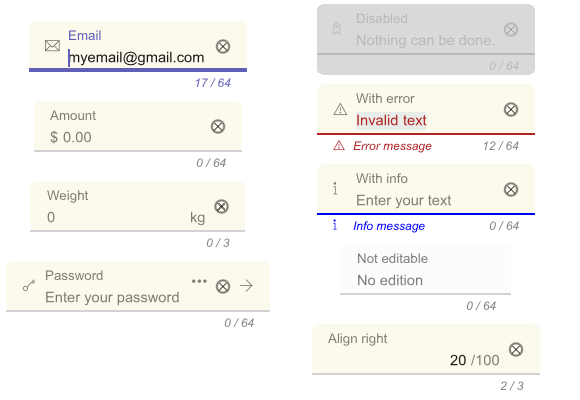

# Input

Input let users enter text into a UI.



## Usage

Text fields provide a container with labels for user input.

## Input type

A text field's type attribute changes how the text field works, such as displaying a different keyboard or providing default validation.

- "text"
- "password"
- "ascii"
- "integer"
- "real"
- "hex"
- "binary"
- "octal"
- "url"
- "pattern"

\newpage

## Labels

Text fields should label their value with a floating label, a placeholder or both. Labels help the user understand what value to input.

``` javascript

function myapp(scope) {
  return skui.vcflex({
    children: [
      skui.input({label: "E-mail"}),
      skui.input({placeholder: "email@domain.com"}),
      skui.input({label: "E-mail", placeholder: "email@domain.com"}),
    ],
  });
}

```

## Icons

Text fields may display optional icons.
Use icons to describe the input method (such as a search icon), provide additional functionality (such as a clear icon).

``` javascript

import { skui, icons } from "skui";

class MyApp extends Component {

function myapp(scope) {
  return skui.vcflex({
    children: [
      skui.input({label: "E-mail", placeholder: "email@domain.com", icon: icons.Email, actionicon: icons.Send}),
    ],
  });
}

skui.init(myapp);

```

## Prefix and suffix
Add prefix and suffix attributes to text fields to display additional context for the value.

``` javascript

import { skui } from "skui";

function myapp(scope) {
  return skui.vcflex({
    children: [
      skui.input({
        label: "Dollar amount",
        type: "number",
        text: "0"
        prefix: "$"
        suffix: ".00"
      }),
    ],
  });
}

skui.init(myapp);

```

## Supporting data

Supporting data conveys additional information about the input field, such as how it will be used. Supporting text can be replaced with error text when validating.

``` javascript

import { skui } from "skui";

function myapp(scope) {
  return skui.vcflex({
    children: [
      skui.input({
        label: "Name*",
        supporting: {
          text: "*required",
          type: "info"
        },
      }),
    ],
  });
}

skui.init(myapp);

```

## Character counter

Text fields will display a character counter base on maxlength (64 by default) if it's not hidden.

``` javascript

import { skui } from "skui";

function myapp(scope) {
  return skui.vcflex({
    children: [
      skui.input({label: "Title", text: "Short",  maxlength: 10}),
    ],
  });
}

skui.init(myapp);

```

\newpage

## Validation

Text fields that validate can use constraint validation or manual validation.

### Constraint validation

Text fields may validate according given type constraints.

``` javascript

import { skui } from "skui";

function myapp(scope) {
  return skui.vcflex({
    children: [
      skui.input({
        type: "pattern",
        label: "Email",
        pattern: "[\w\d-]+",
        suffix="@gmail.com"
      }),
    ],
  });
}

skui.init(myapp);

```

### Manual validation

Alternatively, text fields can manually control their error state and error message.
Use manual validation if the text fields are driven by application logic across supporting property.

``` javascript

import { skui } from "skui";

function validate(name) {
  // ...
}

function mayapp(scope) {
  let text = scope.create("jdoe");
  let supporting = scope.combine(
    values => {
      if (!validate(values[0])) {
        return {text: "Username is not available", type: "error"}
      };
      return {}
    },
    [text]
  );
  return skui.vcflex({
    children: [skui.input({label: "Username", text, supporting})],
  });
}

skui.init(myapp);

```

\newpage

## Tooltip

A tooltip may optionally be added to a text field to express more descriptive label.

``` javascript

import { skui } from "skui";

function myapp(scope) {
  return skui.vcflex({
    children: [
      skui.input({
        label: "Email",
        tooltip: "User email",
      }),
    ],
  });
}

skui.init(myapp);

```

## Accessibility

Add an aria property to text fields with text fields whose labels need to be more descriptive.

``` javascript

import { skui } from "skui";

function mayapp(scope) {
  return skui.vcflex({
    children: [
      skui.input({
        label: "Email",
        aria: "Input to enter the user email",
      }),
    ],
  });
}

skui.init(myapp);

```

\newpage

## Types

| Name                      | Definition                                                                                   |
|---------------------------|----------------------------------------------------------------------------------------------|
| []{#type}*Type*           | "text", "password", "ascii", "integer", "real", "hex", "binary", "octal", "url" or "pattern" |
| []{#selection}*Selection* | {start:number, end:number}                                                                   |


## Properties

| Property             | Type                                         | Default | Description                                   |
|----------------------|----------------------------------------------|---------|-----------------------------------------------|
| disabled&nbsp;       | boolean or Prop`<`boolean`>`                 | false   | Whether or not the input is disabled.         |
| editable&nbsp;       | boolean or Prop`<`boolean`>`                 | true    | Whether or not the input is editable.         |
| placeholder&nbsp;    | string or Prop`<`string`>`                   | ""      | The input placeholder.                        |
| prefix&nbsp;         | string or Prop`<`string`>`                   | ""      | The input prefix.                             |
| suffix&nbsp;         | string or Prop`<`string`>`                   | ""      | The input suffix.                             |
| tooltip&nbsp;        | string or Prop`<`string`>`                   | ""      | The tooltip description.                      |
| icon&nbsp;           | ?icon or ?Prop`<`icon`>`                     | none    | The leading icon.                             |
| actionicon&nbsp;     | ?icon or ?Prop`<`icon`>`                     | none    | The trailing clickable icon.                  |
| aria&nbsp;           | string or Prop`<`string`>`                   | ""      | The accessibility description.                |
| type&nbsp;           | [*Type*](#type) or Prop`<`[*Type*](#type)`>` | "text"  | The type of the input.                        |
| maxlength&nbsp;      | number or Prop`<`number`>`                   | 64      | The maximun number of writable characters.    |
| supporting&nbsp;     | ?supporting or ?Prop`<`supporting`>`         | none    | To specify the supporting behavior.           |
| showcounter&nbsp;    | boolean or Prop`<`boolean`>`                 | true    | The specify the counter visibility.           |
| showsupporting&nbsp; | boolean or Prop`<`boolean`>`                 | true    | The specify the supporting visibility.        |
| showlabel&nbsp;      | boolean or Prop`<`boolean`>`                 | true    | The specify the label visibility.             |
| showclear&nbsp;      | boolean or Prop`<`boolean`>`                 | true    | The specify the clear button visibility.      |
| alignright&nbsp;     | boolean or Prop`<`boolean`>`                 | true    | The specify the text allignment to the right. |
| text&nbsp;           | string or Prop`<`string`>`                   | ""      | The specify the displayed text.               |
| position&nbsp;       | ?Prop`<`number`>`                            | none    | The control the caret position.               |
| selection&nbsp;      | ?Prop`<`[*Selection*](#selection)`>`         | none    | The control the selected text.                |
| configuration&nbsp;  | ?Configuration or ?Prop`<`Configuration`>`   | none    | Container configuration properties.           |

\newpage

### Integer type constraints

| Property | Type                         | Default | Description                      |
|----------|------------------------------|---------|----------------------------------|
| min      | ?number or ?Prop`<`number`>` | none    | Specify the minimum valid value. |
| max      | ?number or ?Prop`<`number`>` | none    | Specify the maximun valid value. |

### Pattern type constraints

| Property | Type                         | Default | Description                   |
|----------|------------------------------|---------|-------------------------------|
| pattern  | ?string or ?Prop`<`string`>` | none    | The supported regexp pattern. |

## Events

| Property    | Type                      | Default | Description                                                          |
|-------------|---------------------------|---------|----------------------------------------------------------------------|
| onaction    | ?(text: string) `=>` void | none    | The input action handler (Pressing enter or action button click)     |
| onfocuslost | ?(text: string) `=>` void | none    | The input lost focus handler (Pressing enter or action button click) |

\newpage